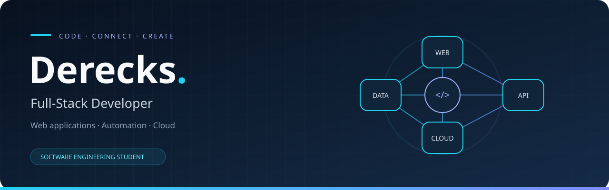

  

  <b>From interactive interfaces to the infrastructure behind them.</b> 
  Full-Stack Developer &amp; software engineering student.

  <a href="#about-me">About me</a> &nbsp;·&nbsp;
  <a href="#what-i-build">What I build</a> &nbsp;·&nbsp;
  <a href="#tech-stack">Tech stack</a> &nbsp;·&nbsp;
  <a href="#github-activity">Activity</a> &nbsp;·&nbsp;
  <a href="https://github.com/dErEcK24Fr?tab=repositories">Explore my repositories ↗</a>

---

## 👋 Hi, I'm Derecks

I build web applications and the systems that power them. My work spans **frontend development, backend services, databases, and deployment**, with a focus on scalable architectures and automation.

I enjoy connecting the pieces: an interface people can use, an API that supports it, and infrastructure that keeps it running.

- 🛠️ Building application ecosystems with **Angular, NestJS, and Node.js**.
- ☁️ Working with **cloud deployment, Docker, and CI/CD**.
- 🐧 Administering **Linux environments** and optimizing databases.
- 🎮 Creating advanced resources and scripts with **Lua**.
- 🔐 Interested in **network security**, automation, and modern software architecture.

## ⚡ What I build

| Area | My focus | Tools |
| --- | --- | --- |
| 🌐 Web & mobile | Interfaces and connected applications | Angular · React · Next.js · Ionic · Tailwind CSS |
| ⚙️ Backend & APIs | Services, integrations, and microservices | NestJS · Node.js · TypeScript · Python · GraphQL |
| 🗄️ Data | Persistence, queries, and caching | PostgreSQL · MongoDB · Redis |
| ☁️ Infrastructure | Containers, deployment, and automation | Docker · AWS · Linux · CI/CD |
| 🎮 Scripting | Custom resources and game logic | Lua |

## 🧰 Tech stack

**Frontend & Mobile:**

**Backend & Databases:**

**Infrastructure, DevOps & Others:**

## 📊 GitHub activity

  
   
   
  

These cards are provided by an external service and reflect the activity GitHub makes available to it.

---

## 🔎 Explore my work

Visit my repositories to explore the code and projects I share.

**[Browse my repositories →](https://github.com/dErEcK24Fr?tab=repositories)**

  Thanks for stopping by 👋 
  <a href="#top">Back to top ↑</a>

